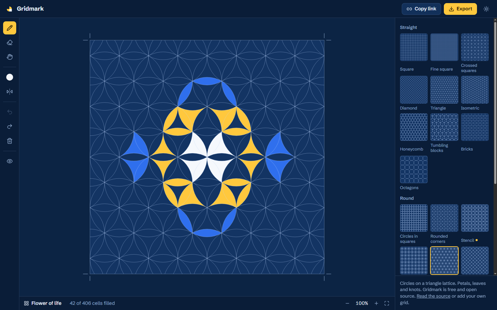
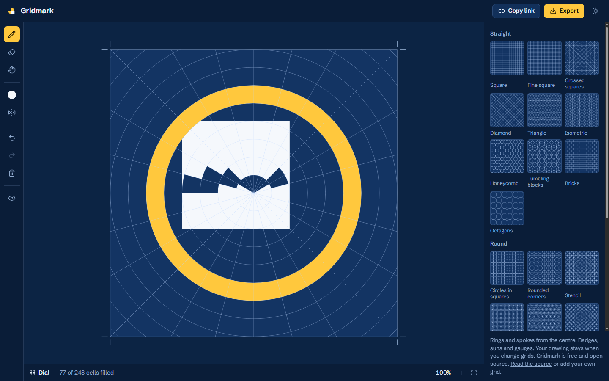
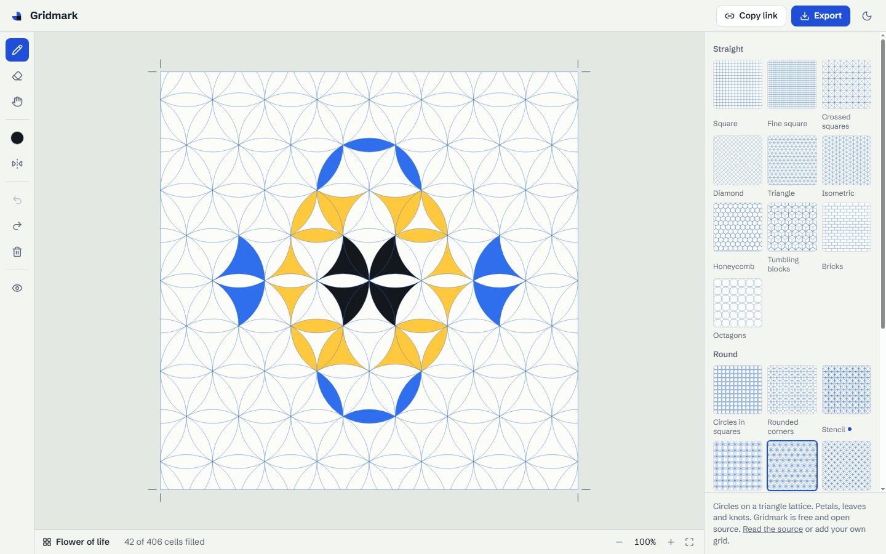
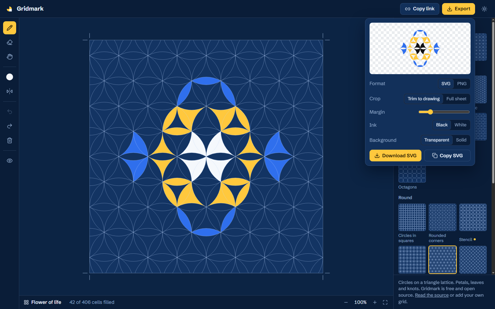

# Gridmark

An open-source grid logo maker. Pick a construction grid, fill its cells, and export the mark as clean SVG or PNG.

**Try it: https://gridmark-21s.pages.dev**

Gridmark runs entirely in the browser. There is no account, no server and no paywall: all 24 grids are free.



It is a free alternative to grid logo tools such as CreateX by LogoFX. It is an independent project, written from scratch, and is not affiliated with LogoFX.

## What it does

- **24 grids** in three families: straight (square, triangle, isometric, honeycomb and more), round (circles in squares, stencil, quatrefoil, flower of life) and radial (dial, compass, two and three centres, golden, fan).
- **Click to fill, drag to fill several.** Click a filled cell again to clear it.
- **One drawing, any grid.** Change grids whenever you like and the drawing stays. Keep adding to it, or cutting into it, with the cells of the new grid.
- **True curves.** Cells on round grids are bounded by real arcs, and the export uses SVG arc commands, not polylines.
- **Merged shapes.** Neighbouring cells of one colour export as a single outline with no seams and no leftover points along straight edges.
- **Mirror drawing** left and right, top and bottom, or both.
- **Ten colours plus any custom colour.** The default ink follows the theme and becomes black or white on export.
- **Export** SVG or PNG (up to 4096 px), trimmed to the drawing or the full sheet, with a transparent or solid background. Or copy the SVG straight to the clipboard.
- **Share links.** The whole drawing is packed into the URL, so a link is all you need to send.
- **Autosave** in the browser, with undo and redo.
- **Blueprint and paper themes**, and a layout that works on a phone.



| Paper theme | Export |
| --- | --- |
|  |  |

## Run it

You need Node.js 20.9 or newer.

```bash
git clone https://github.com/jsxcultivator/gridmark.git
cd gridmark
npm install
npm run dev
```

Open http://localhost:3000.

| Command | What it does |
| --- | --- |
| `npm run dev` | Start the development server |
| `npm run build` | Build the static site into `out/` |
| `npm start` | Serve the built `out/` folder |
| `npm run deploy` | Build and publish to Cloudflare Pages with Wrangler |
| `npm test` | Run the unit tests |
| `npm run typecheck` | Type-check without emitting |

## Host it

`npm run build` writes plain static files to `out/`. Put that folder on any static host. The live demo runs on Cloudflare Pages, and the repository also includes a GitHub Pages workflow; see [docs/DEPLOYMENT.md](docs/DEPLOYMENT.md).

## Documentation

- [User guide](docs/USER_GUIDE.md): tools, shortcuts, export options, share links.
- [Adding a grid](docs/GRIDS.md): how grids are defined and how to write your own.
- [Architecture](docs/ARCHITECTURE.md): how guides become cells, how cells become outlines, and how one drawing spans several grids.
- [Deployment](docs/DEPLOYMENT.md): Cloudflare Pages, GitHub Pages, Vercel, Netlify, or your own server.
- [Contributing](CONTRIBUTING.md)

## Stack

Next.js 16 (App Router, static export), React 19, TypeScript, plain CSS, [Lucide](https://lucide.dev) icons, Vitest. The geometry engine in `src/lib/geometry.ts` has no dependencies.

## Licence

[MIT](LICENSE)
